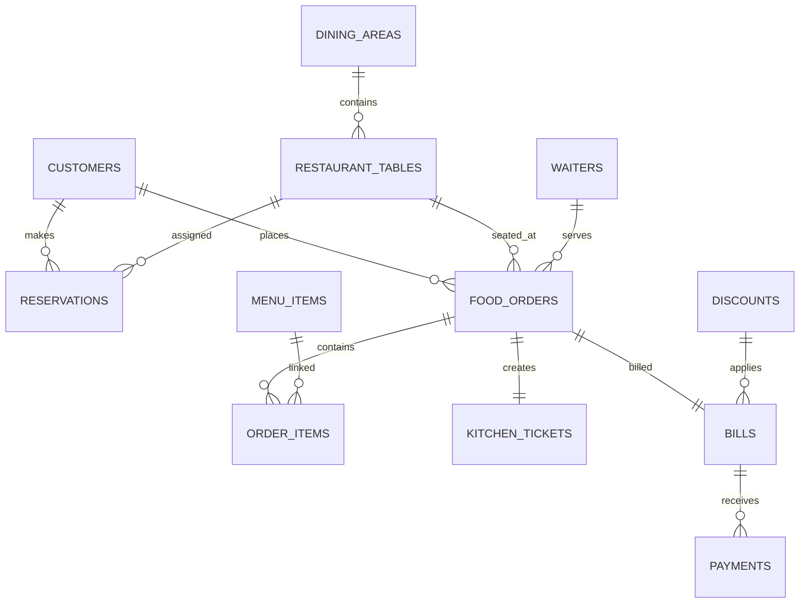

# Restaurant Table Reservation and Food Service Management System

## Overview
This project is a simple DBMS demonstration for a restaurant management system built with Flask, MySQL 8, and server-rendered HTML templates. It focuses on real SQL operations, relational data design, and beginner-friendly database concepts such as primary keys, foreign keys, joins, transactions, and reports.

## Problem Statement
A restaurant needs a system to manage dining areas, reservation records, menu items, food orders, kitchen tickets, bills, and payments. The database must support relational integrity and easy-to-understand SQL queries for viva and practical demonstrations.

## Objectives
- Demonstrate real MySQL database design.
- Use Flask for CRUD operations.
- Show SQL relationships and reports.
- Provide a beginner-friendly interface for practical learning.

## Features
- Dashboard totals from SQL queries
- Dining area and table management
- Customer search and management
- Reservation validation and overlap checks
- Menu item and order creation with multiple items
- Kitchen ticket tracking
- Bill generation and payment recording
- Database explorer using INFORMATION_SCHEMA
- SQL query demonstration page

## Tech Stack
- Frontend: HTML, CSS, Bootstrap 5, JavaScript
- Backend: Python Flask
- Database: MySQL 8
- Connector: mysql-connector-python
- Environment: .env

## Architecture
The Flask app connects to MySQL through `db.py` and executes SQL using parameterized queries. The database schema is defined in `database/schema.sql`, and sample data is loaded from `database/seed.sql`.

## ER Diagram


## Database Tables
- dining_areas: restaurant sections
- restaurant_tables: table capacity and status
- customers: customer records
- waiters: staff assignment
- menu_items: menu catalog
- reservations: future bookings
- food_orders: order master records
- order_items: many-to-many item mapping
- kitchen_tickets: food preparation status
- bills: financial summary per order
- discounts: coupon configuration
- payments: payment history

## Installation
1. Install Python 3.10+
2. Install MySQL 8 and create a user/password.
3. Open the `backend` folder.
4. Create a virtual environment and install `requirements.txt`.

## Windows Setup
```bash
cd C:\Users\Sindol Sidhartha\OneDrive\Desktop\DBMS\backend
python -m venv venv
venv\Scripts\activate
pip install -r requirements.txt
```

## MySQL Setup
```sql
CREATE DATABASE restaurant_db;
USE restaurant_db;
SOURCE database/schema.sql;
SOURCE database/seed.sql;
```

## Environment Variables
Create a `.env` file in the `backend` folder:
```env
DB_HOST=localhost
DB_PORT=3306
DB_USER=root
DB_PASSWORD=your_mysql_password
DB_NAME=restaurant_db
SECRET_KEY=your_secret_key
```

## Run the App
```bash
python app.py
```
Then open `http://localhost:5000`.

## Database Explorer
Visit `http://localhost:5000/db-explorer` to inspect tables, metadata, and sample records from `INFORMATION_SCHEMA`.

## SQL Demo
Visit `http://localhost:5000/sql-demo` to view safe pre-defined SELECT queries and their output.

## Example Queries
- Show all customers
- Show reservation + customer + table join
- Show order + customer totals
- Find the most popular menu item
- Monthly revenue summary
- Pending kitchen tickets

## Screenshots
Screenshots can be added later in this section once the project is run locally.

## Troubleshooting
- If MySQL connection fails, check `.env` values.
- If the schema is missing, import `database/schema.sql`.
- If a page is blank, ensure the database is created and the sample data script is loaded.

## Future Enhancements
- Admin login
- Better reservation editing
- Role-based waiter dashboard
- Excel export
- Better validation and audit logs

## License
This project is for educational use and demonstration purposes.
